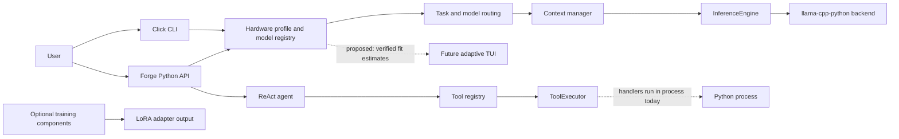

<p align="center">
  <picture>
    <source srcset="assets/brand/eigencore-banner-animated.svg" type="image/svg+xml">
    
  </picture>
</p>

<h1 align="center">EigenCore</h1>
<p align="center">A CPU-first Python runtime for local language models, hardware-aware inference, and agent building blocks.</p>

<p align="center">
  
  
  
</p>

EigenCore profiles a machine, estimates whether a local model fits, and runs inference through `llama-cpp-python` (llama.cpp). It also ships a benchmark harness, a terminal chat, and agent building blocks with a tool policy layer. The transformer math is llama.cpp's; EigenCore owns the judgement around it.

> **Reality check:** a dense 30–40B model at 4-bit is roughly 18–24 GB of weights, more than 8–16 GB of RAM before any KV cache. It can only run by paging from SSD, and decode is then expected to be well under 1 token/s (estimate). Even when a model fits, CPU decode is memory-bandwidth-bound: tok/s ≤ bandwidth ÷ weight bytes. The realistic route to 30B-class models on a 16 GB laptop is a Mixture-of-Experts model, which is planned and not yet measured. See the [review](docs/review/FINAL_REPORT.md) for the arithmetic. No speed figure in this repository is a measurement until a named-hardware run is published.

## Quick start

EigenCore is not published on PyPI yet. Install from source:

```bash
git clone https://github.com/Khubaib7-del/EigenCore.git
cd EigenCore
python -m pip install -e .

eigencore profile
eigencore models
eigencore download tinyllama-1.1b
eigencore run --prompt "Explain binary search in one paragraph"
eigencore chat            # add --plain for scripts or minimal terminals
```

Use `eigencore --help` for every command. `llama-cpp-python` may need a backend-specific install; see its documentation before assuming GPU acceleration (EigenCore currently loads models CPU-only).

## Status

Labels: **SHIPPED** runs on `main` and is tested · **REPORTED-ONLY** computes plans or numbers that never reach llama.cpp · **PLANNED** design docs only.

| Area | Status | Notes |
| --- | --- | --- |
| Inference through llama-cpp-python | SHIPPED | `engine/inference.py`; CPU-only (`n_gpu_layers=0`) |
| Hardware profile | SHIPPED | ISA, RAM, rough single-thread bandwidth probe (reads low). Known bug: recommended context is 2048 on machines under ~38 GB |
| Model-fit estimator | SHIPPED | Weights + reserve + KV + margin, three verdicts. Known bug: the CLI uses a KV fallback that underestimates by ~15–30×; GGUF geometry fix planned |
| Benchmark harness | SHIPPED | `eigencore benchmark --report run.json`; no published runs yet |
| Terminal chat | SHIPPED (core) | Streaming, `--plain`, slash commands, fit header. Full-screen layout and onboarding PLANNED |
| Tool policy | SHIPPED, opt-in | Capabilities, path checks, audit log. Not attached by default in `Forge.agent()`; handlers run in-process (not an OS sandbox); timeout does not stop a running handler |
| Reference kernels | SHIPPED (scalar, NumPy) | RMSNorm, Q8_0 (matches ggml), Q4_0 (**known layout bug**), Q8_0 dot. Not used by inference |
| Layer skipping | REPORTED-ONLY | Planner and estimates only |
| Activation sparsity | REPORTED-ONLY | Predictor never receives activations; `eigencore analyze` measures output-logit sparsity, not neurons |
| Speculative decoding | REPORTED-ONLY | Module not wired; its verifier is not a correct rejection sampler |
| MoE-aware fit, SSD paging warning, KV-type options, GPU offload | PLANNED | See the plan in the review |
| SIMD / native kernels | PLANNED | Research track; decode is bandwidth-bound |
| Training (LoRA/QLoRA) | Code present, not evaluated | Optional `[train]` extra |

## Architecture



This is a module map, not a process-isolation diagram. In particular, the current executor’s validation and timeout are not an OS sandbox or an approval workflow.

## Development

```bash
python -m pip install -e ".[dev]"
pytest tests/ -v
ruff check src/ tests/
ruff format --check src/ tests/
```

See [CONTRIBUTING.md](CONTRIBUTING.md). Report security issues privately as described in [SECURITY.md](SECURITY.md). This project follows a [code of conduct](CODE_OF_CONDUCT.md).

## Documentation

- [Review and plan (2026-11)](docs/review/FINAL_REPORT.md): truth audit, 30–40B arithmetic, prioritized plan, benchmarks to run.
- [Design handbook](docs/design/DESIGN_HANDBOOK.md): v2 identity, palette, terminal UI, approval flow.
- [System architecture](docs/architecture/system-overview.md) and [local inference roadmap](docs/architecture/local-inference-roadmap.md).
- [Terminal chat design](docs/design/terminal-chat.md).
- [Documentation index](docs/INDEX.md).
- [Changelog](CHANGELOG.md).

## Project status

Pre-alpha. APIs and behaviour may change. Feature presence is not a performance claim.

## License

MIT, as declared in `pyproject.toml`. A `LICENSE` file is still to be added by the maintainer.
