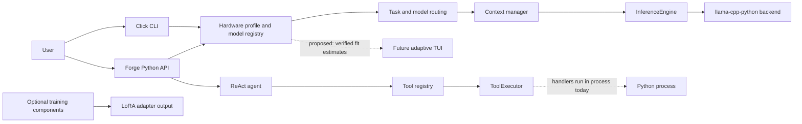

<p align="center">
  
</p>

<h1 align="center">EigenCore</h1>
<p align="center">A CPU-first Python runtime for local language models, hardware-aware inference, and agent building blocks.</p>

<p align="center">
  
  
  
</p>

EigenCore profiles a machine, estimates whether a local model fits, and runs inference through `llama-cpp-python` (llama.cpp). It also ships a benchmark harness, a terminal chat, and agent building blocks with a tool policy layer. The transformer math is llama.cpp's; EigenCore owns the judgement around it.

> **Reality check:** a dense 30–40B model at 4-bit is roughly 18–24 GB of weights, more than 8–16 GB of RAM before any KV cache. It can only run by paging from SSD, and decode is then expected to be well under 1 token/s (estimate). Even when a model fits, CPU decode is memory-bandwidth-bound: tok/s ≤ bandwidth ÷ weight bytes. The realistic route to 30B-class models on a 16 GB laptop is a Mixture-of-Experts model, which is planned and not yet measured. See the [review](docs/review/FINAL_REPORT.md) for the arithmetic. No speed figure in this repository is a measurement until a named-hardware run is published.

## Quick start

Install from PyPI:

```bash
# core CLI (no compiler needed):
python -m pip install eigencore
# + the native inference backend (llama.cpp has no Windows wheel on PyPI,
#   so use the prebuilt index; on GPU machines use the CUDA index instead):
python -m pip install "eigencore[inference]" --extra-index-url https://abetlen.github.io/llama-cpp-python/whl/cpu
# pipx alternative: pipx install "eigencore[inference]"
# from source (development): git clone ... && python -m pip install -e ".[dev,inference]"

eigencore profile
eigencore models
eigencore download tinyllama-1.1b
eigencore run --prompt "Explain binary search in one paragraph"
eigencore chat            # add --plain for scripts or minimal terminals
```

Use `eigencore --help` for every command. `llama-cpp-python` may need a backend-specific install; see its documentation before assuming GPU acceleration (EigenCore currently loads models CPU-only).

## Status

Labels: **SHIPPED** runs on `main` and is tested · **REPORTED-ONLY** computes plans or numbers that never reach llama.cpp · **PLANNED** design docs only.

| Area | Status | Notes |
| --- | --- | --- |
| Inference through llama-cpp-python | SHIPPED | `engine/inference.py`; CPU-only (`n_gpu_layers=0`) |
| Hardware profile | SHIPPED | ISA, RAM, bandwidth probe (reads low). GiB/GB mix fixed; 25% of usable RAM reserved for KV so recommended context no longer pins at 2048 under ~38 GB |
| Model-fit estimator | SHIPPED | Weights (real GGUF file size when downloaded) + reserve + KV from architecture-aware GGUF geometry + margin; GiB end to end. Without geometry the verdict is `UNKNOWN` — no heuristic. CLI passes real GGUF metadata when the model file exists |
| Benchmark harness | SHIPPED | `eigencore benchmark --report run.json`; tokens counted via backend tokenizer, cold/warm reported separately; no published runs yet |
| Terminal chat | SHIPPED | Streaming, `--plain`/NO_COLOR/TERM=dumb auto-detection, width-tiered header, slash commands incl. `/approvals`, sanitized output, safe Ctrl-C. First-run onboarding (fit-grouped model picker + SSD-paging warning, runs once via config) SHIPPED. Full-screen takeover deliberately not done (line mode per TUI.md) |
| Tool policy | SHIPPED, deny-by-default | `ToolExecutor` defaults to `default_policy()` (READ-only, workspace-confined) even when no policy is passed. Path params are declared (`is_path=True`) and resolved to confined absolute paths before handlers. Timeouts run handlers in a spawned process that is killed on timeout. Handlers still run in-process otherwise — not an OS sandbox |
| Tool policy | SHIPPED, deny-by-default | Same as above, plus POSIX rlimits on the child worker and approval cards (`ApprovalManager` + `/approvals` in chat; y/s/n with redacted args, enforced in the executor). Full OS sandbox (cgroups/namespaces) PLANNED |
| Reference kernels | SHIPPED (scalar, NumPy) | RMSNorm, Q8_0/Q4_0 (ggml layout, bit-exact vs gguf-py) and Q4_K super-blocks (bit-exact), Q8_0/Q4_K dots. Not used by inference; SIMD/C-intrinsics lib PLANNED (Stage E) |
| Layer skipping | REPORTED-ONLY | Planner and estimates only |
| Layer pruning (ShortGPT BI) | REPORTED-ONLY (experiment scaffolding) | `engine/pruning.py`: BI scores, head/tail-protected prune plan, kill criterion on quality delta. Not wired into inference; needs owner calibration + perplexity runs |
| Activation sparsity | REPORTED-ONLY | Predictor never receives activations; `eigencore analyze` measures output-logit sparsity, not neurons |
| Activation-sparsity experiment | REPORTED-ONLY (scaffolding) | `engine/sparsity_experiment.py`: mask plan + kill criterion. Dense-model sparsity is a poor near-term bet on bandwidth-bound CPUs (per review); MoE-native routing is the real path |
| Speculative decoding | REPORTED-ONLY | Module not wired into generation; verifier now implements correct rejection sampling (distribution-preserving, tested) but no speedup is measured or claimed |
| MoE-aware fit + SSD-paging warning + decode ceiling on active weights | SHIPPED | `qwen3-30b-a3b` registered; `estimate_fit` reports active/resident/ceiling |
| KV cache type (`--kv fp16|q8_0`) + flash attention (`--no-flash`) on `run`/`chat` | SHIPPED | Engine passes `type_kv`/`flash_attn` to llama.cpp; q8_0 halves KV memory. GPU offload, prompt-lookup decoding PLANNED |
| GPU/VRAM detection + layer offload (`--gpu-layers`, auto-recommend on GPU machines) | SHIPPED | `nvidia-smi` VRAM probe (safe when absent); `gpu_layers_for_vram` fits layers after reserve+KV; `n_gpu_layers` wired into llama.cpp. Prompt-lookup decoding PLANNED |
| Prompt-lookup decoding (`--pld`, default OFF) | SHIPPED (flag) | Copies prompt-verbatim spans and swallows covered backend tokens; copied chars counted. Default stays OFF until owner benchmark §9 item 9 |
| SIMD / native kernels | PLANNED | Research track; decode is bandwidth-bound |
| Training (LoRA/QLoRA) | Code present, not evaluated | Optional `[train]` extra |

## Architecture



This is a module map, not a process-isolation diagram. In particular, the current executor’s validation and timeout are not an OS sandbox or an approval workflow.

## Development

```bash
python -m pip install -e ".[dev,inference]"
pytest tests/ -v
ruff check src/ tests/
ruff format --check src/ tests/
```

See [CONTRIBUTING.md](CONTRIBUTING.md). Report security issues privately as described in [SECURITY.md](SECURITY.md). This project follows a [code of conduct](CODE_OF_CONDUCT.md).

## Documentation

- [Review and plan (2026-11)](docs/review/FINAL_REPORT.md): truth audit, 30–40B arithmetic, prioritized plan, benchmarks to run.
- [Design handbook](docs/design/DESIGN_HANDBOOK.md): v2 identity, palette, terminal UI, approval flow.
- [Terminal UI status and v2 screens](docs/design/TUI.md).
- [Brand assets](assets/brand/README.md).
- [System architecture](docs/architecture/system-overview.md) and [local inference roadmap](docs/architecture/local-inference-roadmap.md).
- [Terminal chat design](docs/design/terminal-chat.md).
- [Documentation index](docs/INDEX.md).
- [Changelog](CHANGELOG.md).

## Project status

Pre-alpha. APIs and behaviour may change. Feature presence is not a performance claim.

## License

[MIT](LICENSE) © 2026 Khubaib Nazeer.
