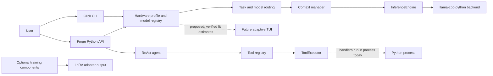

<p align="center">
  
</p>

<h1 align="center">EigenCore</h1>
<p align="center">Chat with AI models that run entirely on your own computer. No account, no cloud, no internet needed after the download.</p>

<p align="center">
  <a href="https://github.com/Khubaib7-del/EigenCore/releases/latest/download/EigenCore-Setup.exe">
    
  </a>
</p>

<p align="center">
  
  
  
</p>

## Get started on Windows

1. **Download** [EigenCore-Setup.exe](https://github.com/Khubaib7-del/EigenCore/releases/latest/download/EigenCore-Setup.exe).
2. **Open it** and click through the installer. It installs just for you, so it doesn't ask for admin rights. If Windows shows "Windows protected your PC", click **More info**, then **Run anyway** (the app isn't code-signed yet).
3. **Start EigenCore** from the Start menu.
4. Go to **Models**, pick one and click **Download**, then **Use**. `tinyllama-1.1b` (0.7 GB) is a good first try.
5. Go back to **Chat** and start typing. You can switch models from the picker under the message box.

**Updating:** click **Update** at the bottom of the sidebar when a new version is out. EigenCore downloads it, installs it over the old one and reopens. Your downloaded models stay where they are.

**Uninstalling:** Settings, then Apps, then Installed apps, then EigenCore, then Uninstall. Models are kept in `C:\Users\<you>\.eigencore\models`; delete that folder too if you want the disk space back.

<details><summary>Prefer not to install? Use the portable version</summary>

Download [EigenCore.exe](https://github.com/Khubaib7-del/EigenCore/releases/latest/download/EigenCore.exe) and double-click it. Nothing is installed, so it won't appear in your app list and it can't update itself. Download the newest copy when you want to update.

</details>

## What to expect

- **Which models will run?** Open the **Profile** tab. It reads your CPU and memory, tells you the largest model size it recommends, and the Models tab marks each model as fits, tight or does not fit.
- **How fast?** Small models (1–3B) are the quickest. Bigger models get slower on a normal CPU, because every word needs the whole model read from memory. The speed under each reply (and in **Monitor**) is measured on your machine; the numbers in **Profile** are estimates.
- **Looks different?** Version 0.4.6 has a new design. It uses Microsoft Edge WebView2, which comes with Windows 11 and most Windows 10 PCs. If it's missing, EigenCore opens in its previous design instead, and everything still works.
- **Privacy:** prompts and replies never leave your computer. The internet is only used to download models and check for updates.

## Use it from the terminal (Windows, macOS, Linux)

Install the command-line version with Python 3.10 or newer:

```bash
python -m pip install eigencore
python -m pip install "eigencore[inference]" --extra-index-url https://abetlen.github.io/llama-cpp-python/whl/cpu
```

The second line adds the part that actually runs the models.

Then:

```bash
eigencore profile                   # what your computer can run
eigencore download tinyllama-1.1b   # get a small model
eigencore chat                      # chat in the terminal
```

<details><summary>All commands</summary>

| Command | What it does |
| --- | --- |
| `eigencore` | Interactive menu |
| `eigencore profile` | Hardware report and recommended model |
| `eigencore models` | List models and whether they fit |
| `eigencore download NAME` | Download a model |
| `eigencore delete NAME` | Remove a model from disk |
| `eigencore run -p "..."` | Ask one question |
| `eigencore chat` | Chat in the terminal (`--plain` for scripts) |
| `eigencore benchmark` | Measure real speed on your machine |
| `eigencore analyze -p "..."` | Output-sparsity report |
| `eigencore train -d data.jsonl` | Fine-tune with QLoRA on CPU |
| `eigencore-gui` | Open the desktop app (needs `eigencore[desktop]`) |

`eigencore --help` lists every option.

</details>

---

## For developers

Everything below is for people working on EigenCore itself.

### Build and test

```bash
python -m pip install -e ".[dev,inference]"
pytest tests/ -v
ruff check src/ tests/
ruff format --check src/ tests/
```

How the desktop app and its installer are built: [docs/desktop.md](docs/desktop.md). How to contribute: [CONTRIBUTING.md](CONTRIBUTING.md). Report security issues privately as described in [SECURITY.md](SECURITY.md). This project follows a [code of conduct](CODE_OF_CONDUCT.md).

### Why big models are slow on a CPU

A dense 30–40B model at 4-bit is about 18–24 GB of weights, more than most laptops' RAM, so it has to page from the SSD and runs well under 1 token/s (estimate). Even when a model fits, speed is capped by memory bandwidth: tokens per second ≤ bandwidth ÷ bytes read per token. The realistic route to 30B-class models on a 16 GB laptop is a Mixture-of-Experts model. The arithmetic is in the [review](docs/review/FINAL_REPORT.md). No speed figure in this repository is a measurement until a run on named hardware is published.

### Feature status

**SHIPPED** runs on `main` and is tested · **REPORTED-ONLY** computes plans or numbers that never reach llama.cpp · **PLANNED** design docs only.

<details><summary>Show the full status table</summary>

| Area | Status | Notes |
| --- | --- | --- |
| Inference through llama-cpp-python | SHIPPED | `engine/inference.py`; CPU-only (`n_gpu_layers=0`) |
| Hardware profile | SHIPPED | ISA, RAM, bandwidth probe (reads low). GiB/GB mix fixed; 25% of usable RAM reserved for KV so recommended context no longer pins at 2048 under ~38 GB |
| Model-fit estimator | SHIPPED | Weights (real GGUF file size when downloaded) + reserve + KV from architecture-aware GGUF geometry + margin; GiB end to end. Without geometry the verdict is `UNKNOWN` — no heuristic. CLI passes real GGUF metadata when the model file exists |
| Benchmark harness | SHIPPED | `eigencore benchmark --report run.json`; tokens counted via backend tokenizer, cold/warm reported separately; no published runs yet |
| Terminal chat | SHIPPED | Streaming, `--plain`/NO_COLOR/TERM=dumb auto-detection, width-tiered header, slash commands incl. `/approvals`, sanitized output, safe Ctrl-C. First-run onboarding (fit-grouped model picker + SSD-paging warning, runs once via config) SHIPPED. Full-screen takeover deliberately not done (line mode per TUI.md) |
| Tool policy | SHIPPED, deny-by-default | Same as above, plus POSIX rlimits on the child worker and approval cards (`ApprovalManager` + `/approvals` in chat; y/s/n with redacted args, enforced in the executor). Full OS sandbox (cgroups/namespaces) PLANNED |
| Reference kernels | SHIPPED (scalar, NumPy) | RMSNorm, Q8_0/Q4_0 (ggml layout, bit-exact vs gguf-py) and Q4_K super-blocks (bit-exact), Q8_0/Q4_K dots. Not used by inference; SIMD/C-intrinsics lib PLANNED (Stage E) |
| Layer skipping | REPORTED-ONLY | Planner and estimates only |
| Layer pruning (ShortGPT BI) | REPORTED-ONLY (experiment scaffolding) | `engine/pruning.py`: BI scores, head/tail-protected prune plan, kill criterion on quality delta. Not wired into inference; needs owner calibration + perplexity runs |
| Activation sparsity | REPORTED-ONLY | Predictor never receives activations; `eigencore analyze` measures output-logit sparsity, not neurons |
| Activation-sparsity experiment | REPORTED-ONLY (scaffolding) | `engine/sparsity_experiment.py`: mask plan + kill criterion. Dense-model sparsity is a poor near-term bet on bandwidth-bound CPUs (per review); MoE-native routing is the real path |
| Speculative decoding | REPORTED-ONLY | Module not wired into generation; verifier now implements correct rejection sampling (distribution-preserving, tested) but no speedup is measured or claimed |
| MoE-aware fit + SSD-paging warning + decode ceiling on active weights | SHIPPED | `qwen3-30b-a3b` registered; `estimate_fit` reports active/resident/ceiling |
| KV cache type (`--kv fp16|q8_0`) + flash attention (`--no-flash`) on `run`/`chat` | SHIPPED | Engine passes `type_kv`/`flash_attn` to llama.cpp; q8_0 halves KV memory. GPU offload, prompt-lookup decoding PLANNED |
| GPU/VRAM detection + layer offload (`--gpu-layers`, auto-recommend on GPU machines) | SHIPPED | `nvidia-smi` VRAM probe (safe when absent); `gpu_layers_for_vram` fits layers after reserve+KV; `n_gpu_layers` wired into llama.cpp. Prompt-lookup decoding PLANNED |
| Prompt-lookup decoding (`--pld`, default OFF) | SHIPPED (flag) | Copies prompt-verbatim spans and swallows covered backend tokens; copied chars counted. Default stays OFF until owner benchmark §9 item 9 |
| SIMD / native kernels | PLANNED | Research track; decode is bandwidth-bound |
| Training (LoRA/QLoRA) | Code present, not evaluated | Optional `[train]` extra |

</details>

### Architecture

<details><summary>Show the module map</summary>



This is a module map, not a process-isolation diagram. In particular, the current executor’s validation and timeout are not an OS sandbox or an approval workflow.

This is a module map, not a process-isolation diagram. Tool handlers run in the same Python process; the tool policy is not an OS sandbox.

</details>

### Documentation

- [Desktop app and installer](docs/desktop.md)
- [Review and plan (2026-11)](docs/review/FINAL_REPORT.md)
- [Design handbook](docs/design/DESIGN_HANDBOOK.md) and [brand assets](assets/brand/README.md)
- [Terminal UI](docs/design/TUI.md) and [terminal chat design](docs/design/terminal-chat.md)
- [System architecture](docs/architecture/system-overview.md) and [local inference roadmap](docs/architecture/local-inference-roadmap.md)
- [Documentation index](docs/INDEX.md) and [changelog](CHANGELOG.md)

Pre-alpha: APIs and behaviour may change. A feature being present is not a performance claim.

## License

[MIT](LICENSE) © 2026 Khubaib Nazeer.
