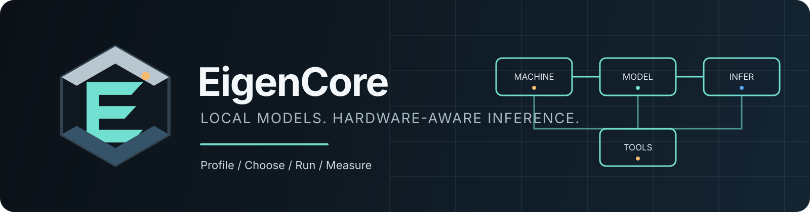
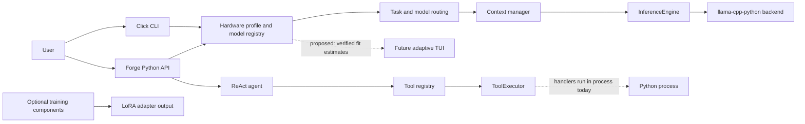

<p align="center">
  
</p>

<h1 align="center">EigenCore</h1>
<p align="center">A CPU-first Python runtime for local language models, hardware-aware inference, and agent building blocks.</p>

<p align="center">
  
  
  
</p>

EigenCore profiles a machine, recommends local models, and runs inference through `llama-cpp-python`. Its current CLI and Python API are the foundation; a full-screen terminal chat experience and hardened agent-tool sandbox are design goals, not shipped features.

> **Reality check:** “30–40B” is not a universal hardware guarantee. Feasibility and speed depend on model architecture, quantization, usable RAM/VRAM, memory bandwidth, context/KV-cache size, and backend build. EigenCore’s speed figures are estimates until measured on named hardware with reproducible benchmark settings.

## Quick start

```bash
python -m pip install eigencore

eigencore profile
eigencore models
eigencore download tinyllama-1.1b
eigencore run --prompt "Explain binary search in one paragraph"
eigencore chat
```

Use `eigencore --help` for the complete command list and options. `llama-cpp-python` may need a backend-appropriate installation for the target CPU/GPU; consult its installation guidance before assuming GPU acceleration is enabled.

## What exists today

- **Hardware profile:** CPU features, memory, and model-fit recommendations.
- **Local inference:** model registry/download and generation through `llama-cpp-python`.
- **Python APIs:** `Forge` for generation, streaming, chat, and routing; inference optimization components for layer-skip/sparsity planning and speculative decoding.
- **Agent building blocks:** ReAct loop, typed tool registry, argument validation, execution timeout, and output truncation.
- **Training code:** CPU-oriented LoRA/QLoRA training components with optional training dependencies.

These components do not imply that each optimization reduces backend work or improves every model: for example, the speculative decoder is initialized but is not currently wired into generation. Tool handlers are not sandboxed. See the [architecture overview](docs/architecture/system-overview.md) for implemented versus proposed boundaries.

## Architecture



This is a module map, not a process-isolation diagram. In particular, the current executor’s validation and timeout are not an OS sandbox or an approval workflow.

## Development

```bash
python -m pip install -e ".[dev]"
pytest tests/ -v
ruff check src/ tests/
ruff format --check src/ tests/
```

## Documentation

- Standalone [EigenCore logo mark](assets/logo/eigencore-mark.svg) and [README banner](assets/banner/eigencore-banner.svg).
- [System architecture](docs/architecture/system-overview.md) — actual module flow, trust boundaries, and staged improvements.
- [Local inference roadmap](docs/architecture/local-inference-roadmap.md) — 30–40B constraints, accuracy/speed tradeoffs, and benchmark gates.
- [Terminal chat design](docs/design/terminal-chat.md) — proposed onboarding, chat layout, tools, approvals, and accessibility.
- [Documentation index](docs/INDEX.md) — architecture, research, and roadmap materials.

## Project status

Pre-alpha; APIs and performance characteristics may change. Feature presence is not a performance claim. Before optimizing kernels or making hardware recommendations, benchmark the existing backend against a quality baseline and record the model, quant, context, hardware, backend flags, and run protocol.
