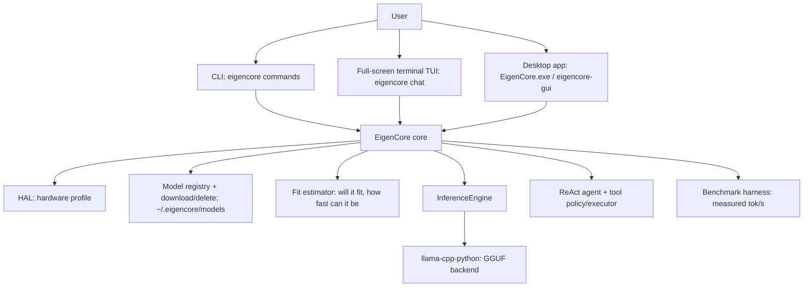

# EigenCore — the full story, in plain language

**Purpose of this document:** a single, clean reference you can read before your
Monday explanation. It covers what EigenCore was, what we built and analyzed,
where the project stands right now (v0.4.4), and the complete architecture and
pipeline. Every technical term has a short "how to explain it" note.

All facts below come from this repository: `README.md`,
[docs/architecture/system-overview.md](architecture/system-overview.md),
[docs/review/FINAL_REPORT.md](review/FINAL_REPORT.md),
[docs/roadmap/phased-plan.md](roadmap/phased-plan.md),
[docs/design/TUI.md](design/TUI.md), [docs/desktop.md](desktop.md), and the
source under `src/eigencore/`.

---

## 1. What EigenCore is (one paragraph)

EigenCore is a **local-first LLM runtime**: a Python package that runs language
models **entirely on your own computer** (CPU-first, GPU-aware), profiles your
hardware, tells you honestly whether a model will fit and how fast it can
possibly run, and provides three front ends — a terminal CLI (`eigencore`),
a full-screen terminal chat (`eigencore chat`), and a Windows desktop app
(`EigenCore.exe` / `eigencore-gui`). The actual number-crunching of the model is
done by **llama.cpp** (via the `llama-cpp-python` binding, using GGUF model
files). EigenCore's own contribution is everything *around* the model: honest
hardware fit estimation, measured benchmarking, a safe terminal/desktop UI, a
model registry with downloads, and agent building blocks with a policy layer.

> **How to explain it:** "We don't write our own GPU math. We take proven
> open models in GGUF format, run them through llama.cpp on the user's own
> machine, and we own the judgment layer — will this model even fit here, how
> fast can it physically be, and how do we present that honestly."

---

## 2. The journey: what we did, in order

1. **Review and honesty pass (PRs #1–#4, rebrand + review).** An independent
   review (`docs/review/FINAL_REPORT.md`) found overclaimed or broken things and
   ranked them. Key finding: several "optimizations" were computed and reported
   but never actually reached the backend — so reported speedups were not real.
   The project adopted a strict labeling rule: **nothing is a measurement until
   a named-hardware benchmark run is published**; everything else is labeled
   "estimate".
2. **Packaging for real users (PRs #17–#18).** `pip install eigencore` originally
   tried to compile `llama-cpp-python` from source, which broke plain Windows
   installs. We moved it to an optional extra `eigencore[inference]` and set up
   **PyPI trusted publishing (OIDC, no tokens in GitHub)** in
   `.github/workflows/release.yml`, so `v*` tags publish automatically.
3. **Windows fixes (PR #19).** The model registry had a 404 filename for
   `qwen2.5-7b` (it is a *sharded* two-file model) and a dead repo for
   `phi-3-mini`. Downloads became shard-aware; bare `eigencore` got an
   interactive menu; `eigencore delete <name>` frees disk; commands no longer
   auto-download a missing default model.
4. **Releases 0.4.1 → 0.4.4.** Version-bump PR + tag per release. While doing
   this we fixed the release pipeline itself: tags must point at the commit that
   reports the new version (else PyPI rejects duplicate filenames — now
   `skip-existing`), the Windows runner has no `zip.exe` (use
   `Compress-Archive`), and `flet pack` has no `--onefile` flag (onefile is the
   default) and needs `--pyinstaller-build-args=--collect-all=llama_cpp` (the `=`
   form is required by argparse) so the exe bundles the native DLL.
5. **Terminal TUI (PR #21).** `eigencore chat` on a TTY now shows an ASCII banner
   with reveal animation, first-run onboarding (model choice grouped by fit),
   then a full-screen app: header (model, context bar, fit, measured tok/s),
   streaming transcript, editable input with history and slash-command
   completion, and `/models` picker with in-TUI switch/download/delete.
   Safety rules kept: model output is sanitized (no escape sequences, no markup
   injection), Ctrl-C stops generation without losing history, a mid-stream
   error never regenerates, every speed number is labeled "measured this turn".
6. **Desktop app (PRs #23, #25–#32).** Flet 1.x GUI (`eigencore[desktop]` extra,
   `eigencore-gui`): dark theme from the brand handbook, Chat / Models / Profile
   screens, sidebar with brand logo + version + **Download** button (direct
   `releases/latest/download/EigenCore.exe` URL), startup update banner. CI
   builds a single-file **`EigenCore.exe`** on a Windows runner and attaches it
   to every GitHub release; the README has a one-click Download button and an
   exe-first quick start. Fixed along the way: `ProfileView.attach` crash,
   update-before-page-add crash, native `llama_cpp` DLL bundling.
7. **Shared storage.** CLI and desktop app both use `~/.eigencore/`
   (`models/` for GGUF files, `config.json` for onboarding state), so models
   downloaded from either appear in both. Pinned by a test.

---

## 3. What we analyzed (and what the analysis concluded)

The review report (`docs/review/FINAL_REPORT.md`) is the anchor. Headline
conclusions:

- **A dense 30–40B model at 4-bit is ~18–24 GB of weights.** On an 8–16 GB RAM
  laptop it can only run by paging from SSD, giving well under 1 token/s
  (estimate). The realistic route to 30B-class models on such hardware is a
  **Mixture-of-Experts (MoE)** model, where only a slice of the weights is
  active per token.
- **CPU decode is memory-bandwidth-bound:** tokens/s ≤ RAM bandwidth ÷ weight
  bytes read per token. Bigger model ⇒ more bytes per token ⇒ slower, regardless
  of CPU speed. This is why "fits in RAM" and "fast" are different questions.
- **Several optimizations were REPORTED-ONLY:** layer-skip plans, sparsity
  predictions, and the speculative decoder were computed and their stats
  printed, but not wired into the actual `create_chat_completion` call — so
  claimed speedups were ~1×. The benchmark harness and the "measured vs
  estimate" labels exist to prevent this class of overclaim.
- **Agent tools are not yet safe to expose in chat:** the policy engine exists
  and is opt-in, but tool handlers run in-process — timeouts are availability
  controls, not containment. Rule adopted: no automatic shell/file/network
  tools until authorization, path policy, process isolation, and audit exist.

> **How to explain "sparse activation":** in a normal (dense) model, every
> neuron layer does full work for every token. "Sparse activation" means only a
> small subset of the network is active per token, so you can skip the rest and
> save compute. MoE is the practical version of this: the model has many
> "expert" sub-networks but routes each token to only a few of them. EigenCore
> measures *output* sparsity (how concentrated the model's choices are) and
> computes sparsity plans, but honestly labels them as not-yet-wired-in.

---

## 4. Where we are now (v0.4.5, 2026-11-13)

- **Published:** PyPI `eigencore` 0.4.5 (sdist + wheel, trusted publishing) and
  GitHub releases with two Windows artifacts: the portable single-file
  **`EigenCore.exe`** (one-click download from the README button) and
  **`EigenCore-Setup.exe`**, an Inno Setup installer (`packaging/windows/EigenCore.iss`)
  that installs per-user into `%LOCALAPPDATA%\Programs\EigenCore` with **no admin
  prompt**, adds a Start menu entry and a normal Settings > Apps uninstaller.
  Models in `~/.eigencore` are never touched by install, update, or uninstall.
- **In-app updates:** the sidebar button now checks GitHub for a newer version
  and, when found, downloads the new installer with a progress bar and runs it
  silently — the app closes, updates in place, and reopens. Logic is in
  `desktop/updater.py` and unit-tested. (Portable / pip installs just open the
  release page.)
- **Front ends:** CLI (Click) with home menu, `run`, `chat`, `analyze`,
  `benchmark`, `train`, `profile`, `models`, `download`, `delete`; full-screen
  terminal TUI; Flet desktop app. All share `~/.eigencore/`.
- **Testing:** 263 tests pass on CI across Python 3.10/3.12 on Ubuntu and
  Windows, plus ruff lint/format. Engine-integration tests require the
  `[inference]` extra (installed in CI with the prebuilt CPU wheel index).
- **Honesty rule in force:** every number is labeled "estimate" or "measured
  this turn/run"; REPORTED-ONLY optimizations are marked as such in README and
  docs.

---

## 5. Full architecture and pipeline

### 5.1 Package layout (`src/eigencore/`)

| Module | What it is | Key files |
| --- | --- | --- |
| `cli/` | Click command group (`eigencore ...`) | `main.py` |
| `tui/` | Terminal UI: banner, full-screen app, key reader, line-mode chat, onboarding, theme | `app.py`, `chat.py`, `keys.py`, `banner.py`, `onboarding.py`, `theme.py` |
| `desktop/` | Flet desktop app: UI-agnostic backend (event queue + worker threads), views, theme, in-app updater, brand assets | `backend.py`, `views.py`, `app.py`, `updater.py`, `theme.py`, `assets/` |
| `engine/` | Inference engine wrapping llama.cpp + optimization components | `inference.py`, `layer_skip.py`, `sparse_inference.py`, `speculative.py`, `prompt_lookup.py`, `pruning.py` |
| `models/` | Curated GGUF registry, shard-aware download/delete, resolve/recommend | `registry.py` |
| `hal/` | Hardware profiler: CPU features, RAM, bandwidth estimate, GPU/VRAM | `profiler.py` |
| `fit/` | Memory-fit estimator + GGUF metadata reader (real geometry when downloaded) | `estimator.py`, `gguf_meta.py` |
| `benchmark/` | Measurement harness (the only source of "measured" numbers) | `harness.py` |
| `agent/` | ReAct loop, grammar, tool registry, executor, approval policy | `react.py`, `tool.py`, `executor.py`, `policy.py` |
| `context/`, `router/`, `analysis/`, `kernels/`, `training/` | Context manager, task router, sparsity analysis, reference Q4K kernels, QLoRA trainer | |
| `forge.py` | Public Python API (`Forge`) | |

### 5.2 The request pipeline, step by step

1. **Entry:** `eigencore chat` / `EigenCore.exe` / `eigencore run`.
2. **Profile hardware** (`hal/profiler.py`): CPU name, cores, instruction sets
   (AVX2/AVX-512/…), total & free RAM, estimated bandwidth, GPU/VRAM if any.
3. **Resolve a model** (`models/registry.py`): pick by name or auto-recommend
   the largest that fits; shard-aware download into `~/.eigencore/models`;
   `delete` removes the files from disk.
4. **Fit estimate** (`fit/estimator.py`): weights + KV cache vs free RAM at a
   chosen context length → verdict `fits_with_margin / tight / does_not_fit /
   unknown` (unknown until the file is downloaded, because exact fit needs the
   GGUF geometry). MoE models report resident GB vs read-per-token GB
   separately. GPU layer offload is computed from VRAM.
5. **Load engine** (`engine/inference.py`): `InferenceEngine` over
   `llama-cpp-python` with KV type (fp16/q8_0), flash attention, GPU layers.
6. **Chat loop:** messages → `stream_messages` → tokens streamed to the UI;
   per-turn measured tok/s is shown and labeled. Ctrl-C / stop keeps history.
7. **UI layer** renders only; all logic lives in testable backends that talk to
   the UI through a thread-safe event queue (desktop) or a sanitized writer
   (terminal). Model text is stripped of terminal control sequences and printed
   without markup parsing.

### 5.3 The release pipeline (how a version ships)

1. PR merges to `main` → CI runs pytest (4 matrix jobs) + ruff.
2. A version-bump PR sets `pyproject.toml` / `__init__.py` / CLI `--version`.
3. Merge → tag `vX.Y.Z` **at the merge commit** → `release.yml` runs:
   - `pypi` job: build sdist+wheel, publish via OIDC trusted publishing
     (`skip-existing` makes re-tags idempotent).
   - one Windows job builds both artifacts on `windows-latest`: the portable
     exe via `flet pack` with `--pyinstaller-build-args=--collect-all=llama_cpp`
     (native DLL bundled; the `=` form is required by argparse), and the
     installer via Inno Setup; it then creates/publishes the GitHub Release
     directly with both files attached — no Actions artifact storage used, and
     the Windows release no longer waits on PyPI.
   - `releases/latest/download/EigenCore.exe` therefore always serves the
     latest portable exe with one click.

---

## 6. Glossary — every technical term, one-line explanation

- **GGUF:** the file format llama.cpp runs models from (quantized weights +
  metadata). Registry entries point at Hugging Face repos; downloads are
  shard-aware (multi-file models like `...-00001-of-00002.gguf`).
- **Quantization (Q4_K_M etc.):** compressing weights to fewer bits (4-bit here)
  so the model file is ~4× smaller and faster to read; small quality trade-off.
- **KV cache:** the model's "memory" of the conversation so far; its size grows
  with context length and dominates RAM use alongside weights. `q8_0` halves it.
- **Context length / window:** how many tokens of conversation the model can
  "see" at once; the fit estimator budgets for it.
- **Tokens & tok/s:** a token ≈ a word piece; tok/s is decode speed, shown only
  when measured on this machine in this turn.
- **Bandwidth-bound decode:** on CPU, each token requires reading all active
  weights from RAM, so tok/s ≈ RAM bandwidth ÷ weight bytes. More params ⇒
  slower, period.
- **MoE (Mixture of Experts):** a model with many expert sub-networks that only
  a few are used per token — big total size, small per-token cost.
- **Sparse activation:** only a subset of the network active per token (see §3);
  EigenCore measures output-logit sparsity with `eigencore analyze` and labels
  plans as REPORTED-ONLY until wired into the backend.
- **Layer skip:** skipping some transformer layers for "easy" tokens.
  Implemented as a scheduler that *reports* plans; not yet applied by llama.cpp.
- **Speculative decoding:** a small draft model proposes several tokens, the big
  model verifies them in one pass — can multiply tok/s when it hits. Decoder
  exists but is not wired into generation yet.
- **Prompt-lookup decoding (PLD):** copy spans that already appear verbatim in
  the prompt instead of decoding them. Off by default until measured.
- **Flash attention:** a memory-efficient attention implementation (less KV
  RAM), toggleable with `--no-flash`.
- **GPU layers:** offloading N transformer layers to the GPU (VRAM permitting),
  auto-recommended when a GPU is detected.
- **Fit verdicts:** `fits_with_margin` / `tight` / `does_not_fit` / `unknown`,
  from the estimator; "unknown" means the model file isn't downloaded so exact
  geometry is unknown.
- **ReAct agent + tool policy:** the agent loop (reason → act → observe) with a
  tool registry; the policy engine is opt-in approval/redaction — enforcement
  below the UI is still pending, so chat ships read-only.
- **QLoRA training:** `eigencore train` fine-tunes on CPU with low-rank adapters
  (optional `train` extra: torch/peft/transformers).
- **Flet / PyInstaller exe:** the desktop app is Python + Flet (Flutter UI);
  `flet pack` bundles it with PyInstaller into one `EigenCore.exe`.
- **Inno Setup installer:** `packaging/windows/EigenCore.iss` builds
  `EigenCore-Setup.exe` — per-user install, Start menu + Apps-list entry +
  uninstaller, never touches `~/.eigencore`.
- **OIDC trusted publishing:** PyPI trusts a short-lived token from GitHub
  Actions instead of a stored API key — no secrets in the repo or CI logs.
- **Trusted publishing / release tags:** `v*` tag push triggers
  `release.yml`; the tag must point at the commit whose version matches,
  otherwise PyPI rejects already-published filenames.

---

## 7. What is deliberately NOT claimed

- No speedup numbers for layer-skip/sparsity/speculative/PLD until measured on
  named hardware (the benchmark harness + §9 of the review list those runs).
- No "safe agent tools in chat" yet — read-only until isolation ships.
- No GPU speed claims — EigenCore loads models CPU-only today; GPU offload of
  layers is computed but backend acceleration is the backend's to prove.

## 8. Pointers

- Review with full arithmetic and the owner benchmark list:
  [docs/review/FINAL_REPORT.md](review/FINAL_REPORT.md)
- Architecture deep-dive and trust boundaries:
  [docs/architecture/system-overview.md](architecture/system-overview.md)
- Roadmap status: [docs/roadmap/phased-plan.md](roadmap/phased-plan.md)
- TUI design decisions: [docs/design/TUI.md](design/TUI.md) ·
  [docs/design/terminal-chat.md](design/terminal-chat.md) · brand tokens:
  [docs/design/DESIGN_HANDBOOK.md](design/DESIGN_HANDBOOK.md)
- Desktop app + exe packaging: [docs/desktop.md](desktop.md)
- Release workflow: [.github/workflows/release.yml](../.github/workflows/release.yml)
