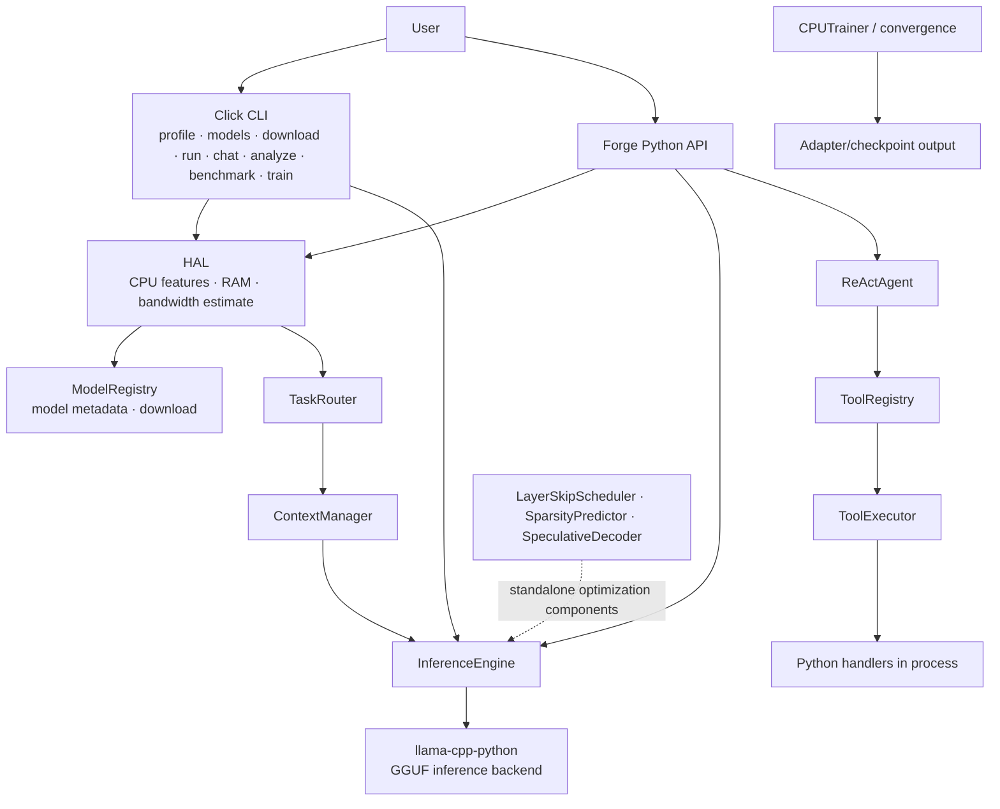

# EigenCore system architecture

**Status:** current source map, with proposed work marked separately. The Python implementation is real, but the package is pre-alpha and its speed/quality claims still need reproducible evidence.

## Current architecture

The diagram reflects modules and documented CLI commands. It does **not** claim that every standalone optimization component is wired into every generation path. Training is an optional component family, not an inference-time stage.

## Layer responsibilities

| Layer | Current responsibilities | Important boundary |
| --- | --- | --- |
| User interface | Click commands and `Forge` API | `eigencore` is the installed command; a full-screen adaptive TUI is proposed, not implemented. |
| Hardware abstraction | CPU/OS feature detection, memory/bandwidth profiling, recommendation inputs | A recommendation is an estimate; measure real decode and prefill on the target machine. |
| Model and routing | Model registry/download, task routing | Model support and routing quality depend on registry metadata and measured compatibility. |
| Inference | `InferenceEngine`, generation configuration/results, llama.cpp Python backend | The native numerical kernel/backend is delegated to llama.cpp; EigenCore does not yet own a low-level inference kernel. |
| Context and agent | Context management, ReAct loop, grammar builder, tool registry/executor | Python handlers execute in-process; argument validation and timeouts do not provide isolation or least privilege. |
| Training | CPU-oriented trainer and convergence utilities | Optional dependencies; training quality and resource use need separate evaluation. |

## Trust and failure boundaries

- Model files and user prompts must be treated as untrusted inputs. The backend handles tensor decoding; future custom loaders must validate formats and lengths before allocation.
- The current executor’s timeout/output cap are availability controls, not containment. A Python handler can access the process’s authority unless separately constrained.
- Do not expose automatic shell/file/network tools as “safe” until authorization, path policy, process isolation, and audit behavior are implemented and tested.
- Future UI approval is a user-intent checkpoint, not a sandbox. Display the exact operation and affected paths, and keep enforcement below the renderer.

## Proposed evolution (not implemented)

1. Establish the baseline through repeatable backend benchmarks and task-quality checks.
2. Add capability-aware hardware/model-fit estimates, with memory safety margins and explicit context/KV-cache cost.
3. Build adaptive CLI/TUI flows over the current API; keep rendering independent of model/tool authority.
4. Harden agent tools with explicit capabilities, deny-by-default policy, observable approvals, and OS-backed process isolation.
5. Prototype own-kernel work only behind an interchangeable backend interface and differential correctness tests against llama.cpp. Promote an optimization only when it preserves the chosen quality bar and improves measured target workloads.

See [local inference roadmap](local-inference-roadmap.md) and [terminal chat design](../design/terminal-chat.md).
