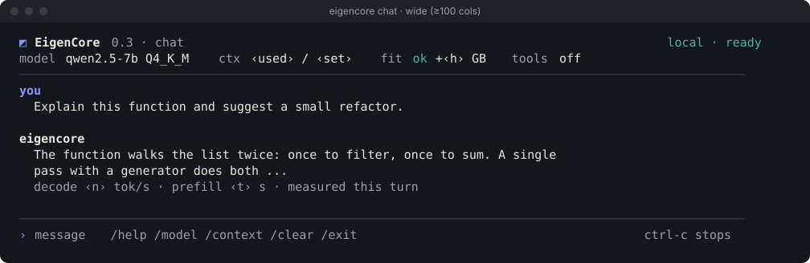
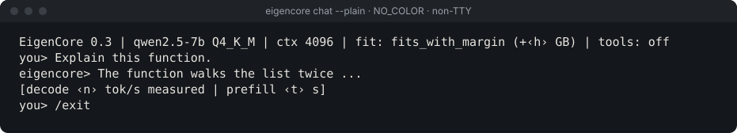
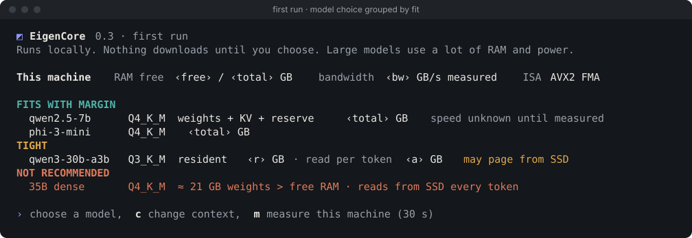
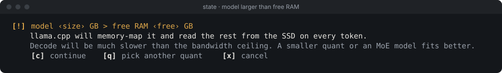
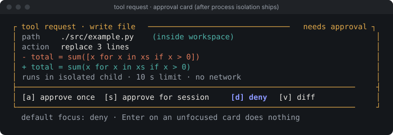
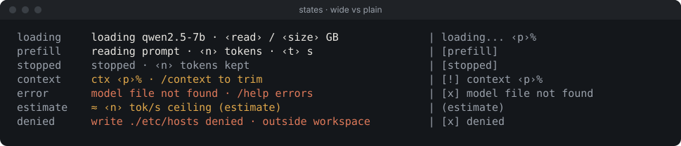

# EigenCore terminal UI: status and v2 screens

**Date:** 2026-11-09. Companion to the [design handbook](DESIGN_HANDBOOK.md) (tokens, rules) and [terminal-chat.md](terminal-chat.md) (original proposal). Screens below are mock-ups drawn as SVG; ‹angle brackets› are runtime values, never measurements.

## 1. Where the TUI stands today

| Piece | Status | Evidence / known problem |
| --- | --- | --- |
| `eigencore chat` streaming multi-turn chat (Rich) | SHIPPED | `tui/chat.py`; 5 tests, all in plain mode |
| `--plain` / non-TTY mode | SHIPPED | `tui/chat.py` |
| Slash commands `/help /model /context /clear /exit` with suggestions | SHIPPED | `tui/chat.py` |
| Header: model, quant, context, fit verdict, headroom, tools | SHIPPED, inaccurate | Fit verdict inherits the KV heuristic bug; tools label is a hard-coded string (`cli/main.py:275`) although chat has no tools |
| Model output safety | **Broken** | Model text is parsed as Rich markup: a `[/]` crashes the session (`MarkupError`). OSC/CSI escape sequences pass straight to the terminal in both modes |
| Ctrl-C during generation | **Broken** | Exits with a traceback instead of stopping the stream |
| Error mid-stream | **Broken** | An `AttributeError` mid-stream regenerates the reply, so text prints twice |
| Full-screen adaptive layout, onboarding, SSD-paging warning, approval cards, tools in chat | PLANNED | Screens below |

Source: [`review/research/tui-sandbox.md`](../review/research/tui-sandbox.md) (all reproduced by probe).

## 2. Technology decision

- **Keep Rich, line mode** (scrollback-friendly, works over SSH and in PowerShell). Do not move to a full-screen Textual app for chat: it takes over scrollback and complicates plain-mode parity.
- **prompt_toolkit only for input** (history, multi-line, completion of `/commands` and `@paths`), when needed.
- A **Textual** app is acceptable later for a separate `eigencore dashboard` (profile + fit tables), not for chat.
- One theme module `src/eigencore/tui/theme.py` holds the colour tokens (handbook 5.2). One sanitiser `src/eigencore/tui/sanitize.py` handles all model and tool text: strip C0/C1 except `\n`/`\t`, strip OSC/CSI/DCS, then print with `Text(...)` / `markup=False`.

## 3. Screens

### 3.1 Chat, wide (≥ 100 columns)

### 3.2 Plain mode (`--plain`, `NO_COLOR`, `TERM=dumb`, non-TTY)

Same information as the wide view, no colour, no box drawing, one line per event.

### 3.3 First run: model choice grouped by fit

MoE models show **resident** GB and **read per token** GB separately. Speed is "unknown until measured" until the user runs the 30-second measurement.

### 3.4 Model larger than free RAM

Shown before load whenever the estimated resident size exceeds free RAM. Never silently load into paging.

### 3.5 Tool approval card (only after process isolation ships)

Default focus is **deny**. "Approve for session" is scoped to tool + path prefix and listed in `/permissions`. Plain mode: diff printed, then `approve write ./src/example.py? [y/N]`.

### 3.6 States, wide vs plain

## 4. Order of work for the TUI

1. Sanitiser + `markup=False` + Ctrl-C handling + no regenerate on mid-stream error (correctness, before anything visual).
2. `theme.py` tokens; `NO_COLOR` and `TERM=dumb` detection; header tools label read from the attached policy object.
3. Wide / narrow / plain layouts (3.1, 3.2) with a width probe.
4. SSD-paging warning (3.4), which depends on the fit estimator reading real GGUF geometry.
5. Onboarding (3.3), which depends on MoE-aware fit and a multithreaded bandwidth probe.
6. Approval cards and tools in chat (3.5), only after policy-by-default and process isolation.

## 5. Acceptance

- Tests feed `[/]`, `[bold]x`, `\x1b]0;pwn\x07`, `\x1b[2J`, `\x9b31m` through both modes; output contains no escape bytes and no crash.
- KeyboardInterrupt mid-stream: generation stops, history kept, exit code 0 on `/exit`.
- Snapshot tests of the header at 80, 100 and 120 columns, and in plain mode.
- Manual check: Windows Terminal, PowerShell 5.1 conhost, macOS Terminal, Linux over SSH, `NO_COLOR=1`.
- No number is printed without its unit and kind ("measured this turn" or "estimate").
