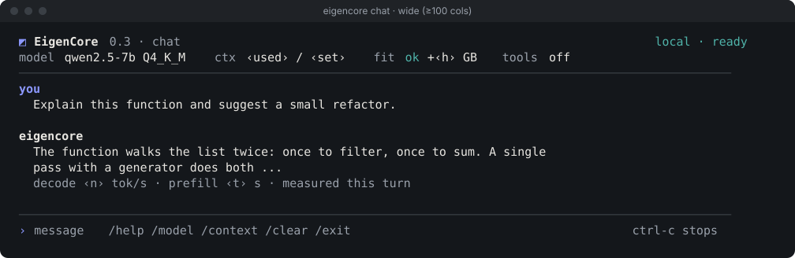
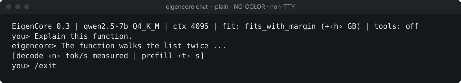
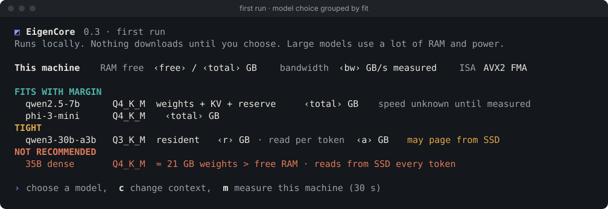
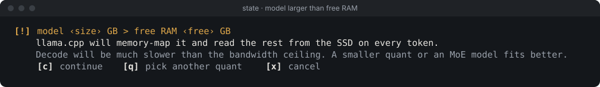
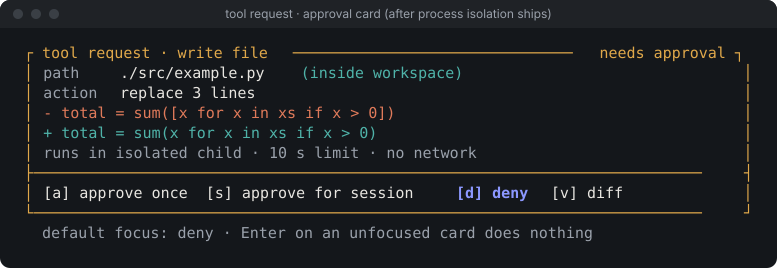
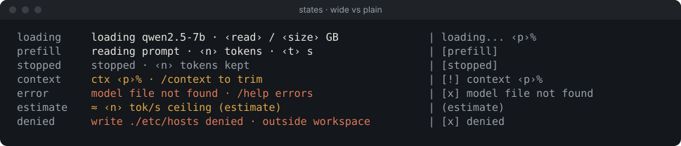

# EigenCore terminal UI: status and v2 screens

**Date:** 2026-11-09. Companion to the [design handbook](DESIGN_HANDBOOK.md) (tokens, rules) and [terminal-chat.md](terminal-chat.md) (original proposal). Screens below are mock-ups drawn as SVG; ‹angle brackets› are runtime values, never measurements.

## 1. Where the TUI stands today

> **2026-11-11 owner decision:** chat goes full-screen (Gemini-CLI-style) on a TTY,
> superseding §2's "keep line mode for chat" for `eigencore chat`. `--plain` /
> non-TTY keeps the line-mode `tui/chat.py` UI, and the safety rules below
> (sanitiser, markup off, Ctrl-C, no regenerate, labeled numbers) all still apply.

**Status as of 2026-11-15 (branch `feat/tui-v2`).** SHIPPED means it runs in `eigencore chat` today and has tests; PLANNED means it does not exist yet.

| Piece | Status | Evidence / known problem |
| --- | --- | --- |
| `eigencore chat` full-screen TUI on a TTY | SHIPPED | `tui/app.py` (ChatApp), `tui/keys.py` (cross-platform key reader; split escape sequences are joined with a 100 ms timeout); `tests/test_tui_app.py`, `tests/test_tui_v2.py` |
| Header per §3.1: `◩ EigenCore <ver> · chat`, right-aligned `local · ready / thinking / writing`; row 2 `model`, `ctx ≈used / set tok`, `fit <verdict> <±h> GB est.`, `tools` | SHIPPED | Snapshot tests at 80, 100, 120 columns and plain (`test_header_snapshot_*`). Fit is read from real GGUF geometry when the file is present, otherwise `fit unknown` with no headroom number |
| Tools label read from the attached policy | SHIPPED | `components.tools_label(policy, tools)`; chat attaches no tools, so it shows `tools off`. The hard-coded "read-only (policy engine attached in P4)" string is gone from `cli/main.py` |
| Wide (≥ 100 cols) / narrow / plain layouts | SHIPPED | Wide: rules under the header and above the footer. Narrow: two short header lines, no rules, footer `› message · /help`. Plain: §3.2 format (`you>` / `eigencore>` / `[decode … tok/s measured \| prefill … s \| … tokens]`) |
| Conversation: `you` / `eigencore` labels, indented bodies, Markdown (lists, inline code, headings left-aligned), framed code blocks with language label + Rich `Syntax` highlighting | SHIPPED | `tui/render.py`. An unclosed fence while streaming renders as an open code panel marked `writing…` (no raw backticks, no reflow when it closes); `test_streaming_unclosed_fence_*` |
| Agent state line while streaming: orb (`◐◓◑◒`, ASCII `\|/-\`, static with `EIGENCORE_REDUCED_MOTION=1`), verb (`Thinking` / `Analyzing` / `Reading prompt` before the first token, `Writing` / `Writing code` after), elapsed seconds; 8 fps, only while generating | SHIPPED | `ChatApp._state_line`; `test_state_line_orb_verb_elapsed_then_stats` |
| Measured stats line: `decode <n> tok/s · prefill <t> s · <n> tokens · measured this turn` | SHIPPED | Tokens come from the engine: `InferenceEngine.stream_messages` now records `last_stream_stats` (token count from the model's tokenizer over the generated text, time to first token, decode time) and `count_tokens()`. An engine with neither is labelled `chunks/s … (stream chunks, not tokens)`. "prefill" is time to first streamed text, so it includes the first token |
| Footer: `›` prompt with placeholder, hints `/help /model /context /clear /exit`, `ctrl-c stops`, context bar (`≈%` of the set context, amber + `/context to trim` at ≥ 85 %) | SHIPPED | Typing `/` shows matching commands; Tab completes. Context use is an estimate (chars / 4) and is marked `≈` |
| Scrollback inside the TUI | SHIPPED | Transcript follows the tail; PgUp / PgDn scroll; finished replies are cached per width |
| In-TUI model picker (switch / download / delete-from-disk) | SHIPPED | `/models` overlay: ↑/↓, Enter switch, `d` download, `x` delete with confirm (default no) |
| In-TUI slash commands | SHIPPED | `/help /models /model /download /delete /context /clear /tokens /temp /exit` with Tab completion and suggestions |
| Model output safety | SHIPPED | One sanitiser, `tui/sanitize.py`: strips CSI / OSC / DCS / SOS / PM / APC (7- and 8-bit), all other C0/C1 except `\n` `\t`; model text is never parsed as Rich markup. §5 acceptance strings tested in both modes |
| Ctrl-C during generation | SHIPPED | Stops the stream, keeps the history and the session (`stopped · <n> tokens kept`); plain mode prints `[stopped]` |
| Error mid-stream | SHIPPED | Partial reply kept, error shown once, never regenerated (both modes; the old `AttributeError` fallback that re-ran the prompt is gone) |
| `NO_COLOR` / `TERM=dumb` / non-TTY / `--plain` → plain | SHIPPED | `theme.probe_terminal` |
| Legacy Windows console | SHIPPED (untested on real conhost) | ASCII glyph set (`[#]`, `>`, `\|/-\`, ASCII boxes) when the encoding is not UTF-8, on conhost without Windows Terminal (`WT_SESSION` unset), or with `EIGENCORE_ASCII=1`; key reader keeps the `msvcrt` path. Manual check on PowerShell 5.1 conhost still to do |
| SSD-paging warning (§3.4) | SHIPPED | `components.SsdWarning`. Before load in `eigencore chat` (interactive: `continue anyway? … (default x)`; non-interactive: printed to stderr), and as an overlay before `/models` switches to a model whose file exceeds free RAM (`[c] continue [q] pick another model [x] cancel`, Enter does nothing) |
| Approval card renderer (§3.5) | SHIPPED as a component only | `components.ApprovalCard` (default focus deny, Enter on an unfocused card does nothing, stale cards cannot be approved, sandbox limits shown only when the executor reports them) and `plain_approval` (`approve write ./x? [y/N]`). **Not shown anywhere in `eigencore chat`: chat has no tools** |
| Tree renderer (`├─ └─ │`, ASCII `\|--` / `` `-- ``) | SHIPPED as a component | `render.render_tree`, `render.tree_from_paths`; not used in chat yet |
| First-run onboarding (§3.3) | PARTIAL | Line-mode picker grouped by fit with MoE resident / read-per-token (`tui/onboarding.py`). PLANNED: hardware table with a multithreaded bandwidth probe, licence / SHA-256 confirm, 30-second "measure this machine" |
| Loading-model progress bar (§3.6) | PLANNED | Loading still uses a Rich status spinner before the full-screen app starts |
| Tools in chat, `/permissions`, `/tools`, audit view | PLANNED | Needs policy-by-default and process isolation first (§4 step 6) |

The original bug list came from [`review/research/tui-sandbox.md`](../review/research/tui-sandbox.md) (all reproduced by probe); every item there is now fixed and covered by a test.

## 2. Technology decision

- **Keep Rich, line mode** (scrollback-friendly, works over SSH and in PowerShell). Do not move to a full-screen Textual app for chat: it takes over scrollback and complicates plain-mode parity.
- **prompt_toolkit only for input** (history, multi-line, completion of `/commands` and `@paths`), when needed.
- A **Textual** app is acceptable later for a separate `eigencore dashboard` (profile + fit tables), not for chat.
- One theme module `src/eigencore/tui/theme.py` holds the colour tokens (handbook 5.2). One sanitiser `src/eigencore/tui/sanitize.py` handles all model and tool text: strip C0/C1 except `\n`/`\t`, strip OSC/CSI/DCS, then print with `Text(...)` / `markup=False`.

## 3. Screens

### 3.1 Chat, wide (≥ 100 columns)

### 3.2 Plain mode (`--plain`, `NO_COLOR`, `TERM=dumb`, non-TTY)

Same information as the wide view, no colour, no box drawing, one line per event.

### 3.3 First run: model choice grouped by fit

MoE models show **resident** GB and **read per token** GB separately. Speed is "unknown until measured" until the user runs the 30-second measurement.

### 3.4 Model larger than free RAM

Shown before load whenever the estimated resident size exceeds free RAM. Never silently load into paging.

### 3.5 Tool approval card (only after process isolation ships)

Default focus is **deny**. "Approve for session" is scoped to tool + path prefix and listed in `/permissions`. Plain mode: diff printed, then `approve write ./src/example.py? [y/N]`.

### 3.6 States, wide vs plain

## 4. Order of work for the TUI

1. Sanitiser + `markup=False` + Ctrl-C handling + no regenerate on mid-stream error (correctness, before anything visual).
2. `theme.py` tokens; `NO_COLOR` and `TERM=dumb` detection; header tools label read from the attached policy object.
3. Wide / narrow / plain layouts (3.1, 3.2) with a width probe.
4. SSD-paging warning (3.4), which depends on the fit estimator reading real GGUF geometry.
5. Onboarding (3.3), which depends on MoE-aware fit and a multithreaded bandwidth probe.
6. Approval cards and tools in chat (3.5), only after policy-by-default and process isolation.

## 5. Acceptance

- Tests feed `[/]`, `[bold]x`, `\x1b]0;pwn\x07`, `\x1b[2J`, `\x9b31m` through both modes; output contains no escape bytes and no crash.
- KeyboardInterrupt mid-stream: generation stops, history kept, exit code 0 on `/exit`.
- Snapshot tests of the header at 80, 100 and 120 columns, and in plain mode.
- Manual check: Windows Terminal, PowerShell 5.1 conhost, macOS Terminal, Linux over SSH, `NO_COLOR=1`.
- No number is printed without its unit and kind ("measured this turn" or "estimate").
